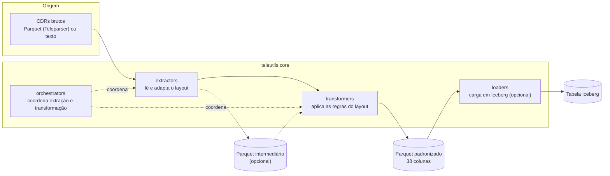

[](https://deepwiki.com/InovaFiscaliza/teleutils)

# TeleUtils

Biblioteca Python que transforma registros de chamadas (CDRs) de diferentes prestadoras de telecomunicações brasileiras em um **dataset único e padronizado**, pronto para análise.

Também oferece utilitários para normalizar números telefônicos e validar CNPJs.

## Sumário

[Visão geral](#visão-geral)

<details>
<summary><a href="#início-rápido">Início rápido</a></summary>

- [Pré-requisitos](#pré-requisitos)
- [Instalação](#instalação)
- [Verificação da instalação](#verificação-da-instalação)

</details>

[Como funciona](#como-funciona)

<details>
<summary><a href="#como-usar">Como usar</a></summary>

- [Extrair CDRs (extratores)](#extrair-cdrs-extratores)
- [Transformar CDRs (transformador)](#transformar-cdrs-transformador)
- [Processar lotes de CDRs (orquestrador)](#processar-lotes-de-cdrs-orquestrador)
- [Carregar o resultado em Iceberg](#carregar-o-resultado-em-iceberg)
- [Módulos auxiliares](#módulos-auxiliares)
  - [Normalizar números e validar CNPJ](#normalizar-números-e-validar-cnpj)
  - [Transferir CDRs para o MinIO](#transferir-cdrs-para-o-minio)

</details>

[Layouts de CDR suportados](#layouts-de-cdr-suportados)

[Estrutura do projeto](#estrutura-do-projeto)

[Documentação técnica](#documentação-técnica)

[Desenvolvimento](#desenvolvimento)

[Limitações conhecidas](#limitações-conhecidas)

[⬆ Voltar ao topo](#sumário)

## Visão geral

Cada prestadora entrega seus CDRs com colunas, formatos de data e hora e
estruturas diferentes. O TeleUtils lê esses arquivos (Parquet do Teleparser ou
texto), aplica as regras de cada layout e grava um Parquet padronizado com
**38 colunas**, com carga opcional em tabelas Iceberg.

Ele é voltado a quem precisa consolidar CDRs de várias fontes em notebooks
Jupyter ou scripts Python com Apache Spark.

### Componentes

Os módulos principais ficam em `teleutils.core` e formam o pipeline de CDRs. Os
demais são acessórios e podem ser usados de forma independente.

| Tipo | Módulo | Função |
| :-- | :-- | :-- |
| Principal | `teleutils.core.extractors` | Lê os arquivos de origem (Parquet ou texto) e gera uma estrutura intermediária. |
| Principal | `teleutils.core.transformers` | Aplica as regras de cada layout e gera o dataset padronizado. |
| Principal | `teleutils.core.orchestrators` | Executa extração e transformação de vários arquivos a partir de uma configuração e informa o resultado de cada um. |
| Principal | `teleutils.core.loaders` | Carrega o dataset padronizado em tabelas Iceberg (`TrinoLoader`). |
| Acessório | `teleutils.preprocessing` | Extrai números telefônicos brasileiros e valida CNPJ, sem Spark. |
| Acessório | `scripts/` | Scripts Bash que enviam CDRs ao MinIO ou os copiam para uma pasta local. |

[⬆ Voltar ao topo](#sumário)

## Início rápido

### Pré-requisitos

| Requisito | Detalhe |
| :-- | :-- |
| Python | 3.9 ou superior |
| Java | Necessário para os fluxos que usam Apache Spark |
| Git | Para obter o repositório |
| `jq` e `mc` (MinIO Client) | Apenas para os scripts de envio ao MinIO; a cópia local exige só `jq` |

As bibliotecas Python (`minio`, `pandas`, `pyarrow`, `pyspark`) são instaladas
automaticamente.

### Instalação

```bash
git clone https://github.com/InovaFiscaliza/teleutils.git
cd teleutils
uv sync
```

Alternativa, em um ambiente virtual já ativado: `python -m pip install .`

### Verificação da instalação

Este comando não inicia o Spark:

```bash
uv run python -c "from teleutils.preprocessing import extract_number; print(extract_number('5511987654321'))"
```

Saída esperada:

```text
ExtractionResult(number='11987654321', success=True)
```

[⬆ Voltar ao topo](#sumário)

## Como funciona



1. O **extrator** do layout lê o arquivo e produz uma estrutura intermediária.
   Ele pode gravá-la em Parquet ou repassá-la diretamente ao transformador.
2. O **transformador** padroniza datas, números e demais campos e grava o Parquet padronizado.
3. O **orquestrador** repete essas etapas para vários arquivos, sem interromper o lote quando um item falha.
4. O **loader** (opcional) carrega o resultado em uma tabela Iceberg.

Os dados gerados em cada etapa **substituem** o conteúdo existente no destino
informado (modo `overwrite`).

[⬆ Voltar ao topo](#sumário)

## Como usar

Os exemplos abaixo são ilustrativos: ajuste caminhos, bucket e nomes ao seu
ambiente. Parâmetros e contratos completos estão na
[referência da API](docs/teleutils_api.md). Os exemplos a seguir pressupõem uma
`SparkSession` já criada na variável `spark`.

### Extrair CDRs (extratores)

O extrator lê o arquivo de origem, seleciona e renomeia as colunas do layout e
grava um Parquet intermediário. Há um extrator para cada formato de origem:

| Classe | Entrada |
| :-- | :-- |
| `CDRParquetExtractor` | Parquet do Teleparser |
| `CDRTextExtractor` | Texto (CSV, delimitado ou de largura fixa) |

```python
from teleutils.core.extractors import CDRParquetExtractor, CDRTextExtractor

# Parquet do Teleparser
parquet_extractor = CDRParquetExtractor(spark)
intermediate = parquet_extractor.extract(
    source_file="dados/prestadora/smp/ericsson/entrada.parquet",
    target_file="saida/intermediario/ericsson",
    cdr_schema="smp_ericsson_gsm",
)

# Arquivos de texto
text_extractor = CDRTextExtractor(spark)
text_intermediate = text_extractor.extract(
    source_file="dados/prestadora/stfc/huawei_ngn/entrada.csv",
    target_file="saida/intermediario/huawei_ngn",
    cdr_schema="stfc_huawei_ngn",
)
```

- `cdr_schema` indica o layout (veja [Layouts de CDR suportados](#layouts-de-cdr-suportados)).
- O retorno é o caminho gravado, ou `None` se a entrada não for encontrada (um
  aviso é registrado e nada é gravado). Verifique o retorno antes da próxima etapa.
- Os metadados `prestadora`, `servico`, `tipo_cdr` e `arquivo_origem` são
  inferidos da estrutura `.../operator/service/cdr_type/arquivo`. Para
  informá-los explicitamente, use `operator=`, `service=` e `cdr_type=`.
- O destino é sobrescrito se já existir.

### Transformar CDRs (transformador)

O transformador converte a estrutura extraída para o dataset padronizado de 38
colunas. Cada layout tem seu método `transform_<layout>` em `CDRTransformer`:

```python
from teleutils.core.transformers import CDRTransformer

transformer = CDRTransformer(spark)
result = transformer.transform_smp_ericsson_gsm(
    source_file=intermediate,  # retorno da extração
    target_file="saida/padronizado/ericsson",
)
print(result)  # caminho do Parquet padronizado
```

- `source_file` aceita o Parquet intermediário ou um DataFrame (veja abaixo).
- O Parquet final é particionado por `no_tipo_chamada` e sobrescreve o destino
  se ele já existir.
- Os layouts `stfc_tropico_claro_lega` e `stfc_tropico_claro_legb` têm métodos
  próprios com esses nomes (`transform_stfc_tropico_claro_lega` e
  `transform_stfc_tropico_claro_legb`).

Para evitar gravar o Parquet intermediário, use `extract_dataframe` (disponível
nos dois extratores) e passe o DataFrame ao transformador. Nesse modo, crie o
extrator com a sessão do transformador (`transformer.spark`):

```python
transformer = CDRTransformer(spark)
extractor = CDRParquetExtractor(transformer.spark)

df = extractor.extract_dataframe(
    source_file="dados/prestadora/smp/ericsson/entrada.parquet",
    cdr_schema="smp_ericsson_gsm",
)
if df is not None:  # None: entrada não encontrada
    transformer.transform_smp_ericsson_gsm(
        source_file=df,
        target_file="saida/padronizado/ericsson",
    )
```

DataFrames criados em outra sessão Spark são rejeitados.

### Processar lotes de CDRs (orquestrador)

O orquestrador executa extração e transformação em sequência para um ou vários tipos de CDRs e é a forma recomendada de processar CDRs em notebooks:

```python
from teleutils.core.orchestrators import run_etl

cdr_config = [{
    "source_folder": "bucket-exemplo/cdr/bruto/algar/stfc/huawei_ngn",
    "pattern": "*.gz",
    "schema": "stfc_huawei_ngn",
    "extracted_folder": "bucket-exemplo/cdr/extraido",
    "transformed_folder": "bucket-exemplo/cdr/transformado",
    "output_file_prefix": "algar_huawei_ngn",
}]

report = run_etl(cdr_config, spark=spark)
print(report.total, report.successes, report.validation_errors, report.execution_errors)
```

Campos de cada item da configuração:

| Campo | Obrigatório | Descrição |
| :-- | :-- | :-- |
| `source_folder` | Sim | Pasta com os arquivos de origem. |
| `pattern` | Sim | Máscara dos arquivos a processar (por exemplo, `*.gz`). |
| `schema` | Sim | Layout do CDR (veja [Layouts de CDR suportados](#layouts-de-cdr-suportados)). |
| `extracted_folder` | Sim | Pasta de destino dos dados extraídos. |
| `transformed_folder` | Sim | Pasta de destino dos dados padronizados. |
| `output_file_prefix` | Sim | Prefixo dos nomes de saída (`<prefixo>_extracted.parquet` e `<prefixo>_transformed.parquet`). |
| `operator`, `service`, `cdr_type` | Não | Metadados da origem; quando omitidos, são inferidos da estrutura `.../operator/service/cdr_type/arquivo`. |
| `storage_type` | Não | `"s3a"` (padrão, MinIO/S3) ou `"local"` (diretórios absolutos, como `/dados/cdr`). |

Pontos de atenção:

- confira o relatório (`report.items`): o término do lote não significa que todos
  os itens tiveram sucesso;
- um mesmo item usa um único tipo de armazenamento para origem e destinos;
- para ler a configuração de um JSON, use `load_config`; para listar arquivos
  no MinIO, use `list_files`;
- `run_etl(..., materialize_intermediate=False)` dispensa o Parquet
  intermediário e `extracted_folder`.

[⬆ Voltar ao topo](#sumário)

### Carregar o resultado em Iceberg

Use uma sessão Spark com extensões e catálogo Iceberg compartilhado com o Trino:

```python
from teleutils.core.loaders import TrinoLoader

loader = TrinoLoader(spark)
loader.upsert_iceberg(
    "/dados/cdr_padronizado.parquet",
    "catalogo.schema.chamadas",
)
```

Origens novas são inseridas. Em recargas, o loader exclui somente as linhas
cujos valores de `no_arquivo_origem` aparecem na entrada e depois insere todo
o Parquet. Cada nome deve identificar uma única origem por tabela, e a entrada
deve conter todas as linhas das origens que apresenta.

Exclusão e inserção têm commits separados. Serialize as escritas no destino e
mantenha a entrada disponível para reprocessamento. Veja a
[referência da API](docs/teleutils_api.md#teleutilscoreloaders) para detalhes.

### Módulos auxiliares

Além do pipeline de CDRs, o projeto inclui utilitários independentes, que não
dependem do Spark nem uns dos outros:

| Utilitário | Para que serve |
| :-- | :-- |
| `teleutils.preprocessing` | Normalizar números telefônicos e validar CNPJ. |
| `scripts/` | Enviar CDRs ao MinIO ou copiá-los para uma pasta local. |

#### Normalizar números e validar CNPJ

```python
from teleutils.preprocessing import extract_number, is_valid_cnpj

result = extract_number("5511987654321")
print(result.number, result.success)  # 11987654321 True

is_valid_cnpj("11.222.333/0001-81")  # True
```

`extract_number` retorna o número extraído e um indicador de sucesso; se nada for
reconhecido, devolve o valor original com `success=False`. `is_valid_cnpj`
aceita CNPJ numérico e alfanumérico.

#### Transferir CDRs para o MinIO

Os scripts de `scripts/` selecionam os CDRs de uma semana (`SemanaNNN`) e os
enviam ao MinIO ou os copiam para uma pasta local, sem alterar a origem. Todos
usam o mesmo arquivo de configuração JSON
(`scripts/uploader.config.example.json`) e aceitam `--dry-run` (planeja sem
copiar) e `--help`.

| Script | Uso |
| :-- | :-- |
| `scripts/upload_cdr_to_minio.sh` | Envio ao MinIO com `mc`, em lotes sequenciais. |
| `scripts/upload_cdr_to_minio_parallel.sh` | Envio ao MinIO com várias cópias simultâneas (`--jobs`). Requer Bash 4.4. |
| `scripts/copy_cdr_to_local.sh` | Cópia para um diretório local (`--destination`, `--jobs`). Não usa `mc`. Requer Bash 4.4. |

```bash
./scripts/upload_cdr_to_minio.sh \
  --config scripts/uploader.config.example.json --week-dir Semana110 \
  --teleparser-folder /data/teleparser/ --dry-run
```

O formato do JSON, as opções e os códigos de saída estão em
[Transferência semanal de CDRs para MinIO](docs/teleutils_upload_cdr_to_minio.md).

[⬆ Voltar ao topo](#sumário)

## Layouts de CDR suportados

São 17 layouts, informados no campo `schema` (ou em `cdr_schema`):

| Formato de origem | Layouts |
| :-- | :-- |
| Parquet (Teleparser) | `smp_ericsson_gsm`, `smp_nokia_gsm`, `smp_huawei_volte_tim`, `smp_ericsson_volte_vivo`, `stfc_italtel_ngn_tim`, `stfc_sigma_claro` |
| Texto (CSV, delimitado ou largura fixa) | `stfc_huawei_ngn`, `stfc_huawei_ngn_tim`, `stfc_fcdr_vivo`, `stfc_7n_oi`, `stfc_tropico_oi`, `stfc_axe_claro`, `stfc_pcl_claro`, `stfc_tropico_claro_lega`, `stfc_tropico_claro_legb`, `stfc_pit_claro`, `stfc_ss8bf_claro` |

[⬆ Voltar ao topo](#sumário)

## Estrutura do projeto

```text
teleutils/
├── src/teleutils/
│   ├── core/
│   │   ├── extractors/       # leitura dos CDRs e catálogo de layouts
│   │   ├── transformers/     # regras de transformação e dataset final
│   │   ├── orchestrators/    # execução em lote a partir de configuração
│   │   └── loaders/          # carga em Iceberg
│   ├── preprocessing/        # números telefônicos e CNPJ
│   └── robocalls/            # pacote depreciado
├── scripts/                  # envio e cópia semanal de CDRs (Bash)
├── docs/                     # documentação técnica
├── tests/                    # testes automatizados e notebooks de apoio
└── pyproject.toml            # metadados e dependências
```

[⬆ Voltar ao topo](#sumário)

## Documentação técnica

| Documento | Descrição |
| :-- | :-- |
| [Referência da API](docs/teleutils_api.md) | Interfaces públicas, parâmetros, retornos, erros e efeitos colaterais. |
| [Modelo de dados dos CDRs](docs/teleutils_modelo_de_dados.md) | Campos do contrato final dos transformadores e seus significados. |
| [Linhagem e transformações dos dados](docs/teleutils_linhagem_transformacoes_dados.md) | Origem, regras de transformação e destino das colunas dos CDRs. |
| [Transferência semanal de CDRs para MinIO](docs/teleutils_upload_cdr_to_minio.md) | Scripts Bash de envio e cópia local: configuração JSON, opções, relatório e testes. |

[⬆ Voltar ao topo](#sumário)

## Desenvolvimento

```bash
uv sync --all-groups
uv run pytest
```

O grupo `dev` de `pyproject.toml` inclui `pytest`, `ruff` e `pre-commit`; os
hooks de `.pre-commit-config.yaml` executam `ruff`, `mypy`, `nbstripout` e
verificações básicas. Os scripts Bash são testados com Bats:

```bash
bats tests/shell/upload_cdr_to_minio.bats
bats tests/shell/upload_cdr_to_minio_parallel.bats
bats tests/shell/copy_cdr_to_local.bats
```

[⬆ Voltar ao topo](#sumário)

## Limitações conhecidas

- O orquestrador não oferece transação entre etapas, retentativas, paralelismo,
  retomada automática nem carga em Iceberg; saídas parciais não são removidas.
- Os testes não certificam o acesso S3A de um ambiente Big Data específico.
- `CDRTransformer.transform` não localiza os métodos de layout da instância: use
  `transform_<layout>` ou o orquestrador.
- Não há CLI Python; os únicos utilitários de linha de comando são os scripts Bash.
