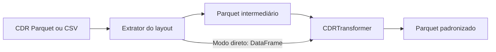

[](https://deepwiki.com/InovaFiscaliza/teleutils)

# TeleUtils

Biblioteca Python para normalizar dados de telecomunicações e processar
registros de chamadas (CDRs) de prestadoras brasileiras. O projeto oferece
funções para números telefônicos e CNPJs, além de extratores, transformadores,
um orquestrador e um loader Apache Spark que convertem diferentes layouts de CDR
em um contrato analítico comum.

## Sumário

[Visão geral](#visão-geral)

<details>
<summary><a href="#início-rápido">Início rápido</a></summary>

- [Pré-requisitos](#pré-requisitos)
- [Instalação](#instalação)
- [Verificação da instalação](#verificação-da-instalação)

</details>

[Componentes e fluxo](#componentes-e-fluxo)

<details>
<summary><a href="#uso">Uso</a></summary>

- [Pré-processamento em Python](#pré-processamento-em-python)
- [Processamento de CDRs com Spark](#processamento-de-cdrs-com-spark)
- [Orquestração de lotes no Jupyter](#orquestração-de-lotes-no-jupyter)
- [Carga Iceberg com controle de arquivos](#carga-iceberg-com-controle-de-arquivos)
- [Transferência de CDRs para o MinIO](#transferência-de-cdrs-para-o-minio)

</details>

[Estrutura do projeto](#estrutura-do-projeto)

[Documentação técnica](#documentação-técnica)

[Desenvolvimento](#desenvolvimento)

[Limitações conhecidas](#limitações-conhecidas)

[⬆ Voltar ao topo](#sumário)

## Visão geral

O `teleutils` atende dois cenários principais:

- extração de números telefônicos brasileiros (`extract_number`) e validação de
  CNPJ numérico ou alfanumérico (`is_valid_cnpj`);
- extração de CDRs Parquet do Teleparser ou texto (CSV, delimitado ou de largura
  fixa) para uma representação intermediária e transformação desse resultado em
  um dataset Parquet padronizado de 38 colunas, com carga opcional em Iceberg.

Há 17 layouts de CDR: seis em Parquet (`smp_ericsson_gsm`, `smp_nokia_gsm`,
`smp_huawei_volte_tim`, `smp_ericsson_volte_vivo`, `stfc_italtel_ngn_tim` e
`stfc_sigma_claro`) e onze em texto (`stfc_huawei_ngn`, `stfc_huawei_ngn_tim`,
`stfc_fcdr_vivo`, `stfc_7n_oi`, `stfc_tropico_oi`, `stfc_axe_claro`,
`stfc_pcl_claro`, `stfc_tropico_claro_lega`, `stfc_tropico_claro_legb`,
`stfc_pit_claro` e `stfc_ss8bf_claro`). O processamento usa Spark e grava os
destinos em modo `overwrite`; a saída transformada é particionada por
`no_tipo_chamada`. O pacote `teleutils.robocalls` está depreciado e não é
documentado aqui.

[⬆ Voltar ao topo](#sumário)

## Início rápido

### Pré-requisitos

- Python 3.9 ou superior (`requires-python = ">=3.9"`; `.python-version` fixa 3.9);
- um ambiente Java funcional para os fluxos que iniciam o Apache Spark;
- Git para obter o repositório.

As dependências de execução declaradas em `pyproject.toml` são `minio>=7.2.0`,
`pandas>=2.3.3`, `pyarrow==21.0.0` e `pyspark>=3.5.5`. O script Bash de
transferência para o MinIO exige, além disso, `jq` e o MinIO Client `mc`.

### Instalação

Com `uv`:

```bash
git clone https://github.com/InovaFiscaliza/teleutils.git
cd teleutils
uv sync
```

Para instalar apenas o pacote em um ambiente virtual já ativado:

```bash
python -m pip install .
```

### Verificação da instalação

Execute uma chamada que não precisa iniciar o Spark:

```bash
uv run python -c "from teleutils.preprocessing import extract_number; print(extract_number('5511987654321'))"
```

Resultado esperado:

```text
ExtractionResult(number='11987654321', success=True)
```

[⬆ Voltar ao topo](#sumário)

## Componentes e fluxo



- `teleutils.preprocessing`: extração de números telefônicos e validação de
  CNPJ em Python puro, sem Spark;
- `teleutils.core.extractors`: leitura, seleção, renomeação e enriquecimento de
  CDRs com metadados de origem;
- `teleutils.core.extractors.schemas`: contratos e catálogos dos layouts
  aceitos pelos extratores;
- `teleutils.core.transformers`: regras específicas por layout e pipeline comum
  de padronização do dataset final;
- `teleutils.core.orchestrators`: validação de configurações e coordenação
  sequencial de extração e transformação, com relatório por item e por lote;
- `teleutils.core.loaders`: `TrinoLoader`, carga independente do Parquet final em
  tabelas Iceberg, com controle opcional de arquivos já carregados.

Os extratores podem inferir `prestadora`, `servico`, `tipo_cdr` e `arquivo_origem`
da estrutura `.../operator/service/cdr_type/arquivo`. Os argumentos opcionais
`operator`, `service` e `cdr_type` permitem informar metadados explicitamente;
`_tipo_cdr` do conteúdo, quando presente, prevalece sobre o tipo informado.

[⬆ Voltar ao topo](#sumário)

## Uso

### Pré-processamento em Python

```python
from teleutils.preprocessing import extract_number, is_valid_cnpj

resultado = extract_number("5511987654321")
print(resultado.number, resultado.success)  # 11987654321 True

cnpj_valido = is_valid_cnpj("11.222.333/0001-81")  # True
```

`extract_number` retorna um `ExtractionResult(number, success)`. Se nenhuma
extração for aceita, `number` mantém o valor de entrada e `success` é `False`;
entradas vazias retornam o valor sentinela `5599999999999`. `is_valid_cnpj`
também aceita o CNPJ alfanumérico. Consulte os contratos completos na referência
da API.

### Processamento de CDRs com Spark

Crie a sessão Spark e instancie o extrator e o transformador:

```python
from pyspark.sql import SparkSession

from teleutils.core.extractors import CDRParquetExtractor
from teleutils.core.transformers import CDRTransformer

spark = SparkSession.builder.appName("teleutils").getOrCreate()

extractor = CDRParquetExtractor(spark)
transformer = CDRTransformer(spark)

intermediario = extractor.extract(
    source_file="dados/prestadora/smp/ericsson/entrada.parquet",
    target_file="saida/intermediario/ericsson",
    cdr_schema="smp_ericsson_gsm",
)
resultado = transformer.transform_smp_ericsson_gsm(
    source_file=intermediario,
    target_file="saida/padronizado/ericsson",
)
```

Os métodos retornam o caminho de destino. Tanto a extração quanto a
transformação substituem dados já existentes no destino informado.

#### Sem Parquet intermediário

Crie o transformador primeiro e use sua sessão no extrator:

```python
transformer = CDRTransformer(spark)
extractor = CDRParquetExtractor(transformer.spark)
df = extractor.extract_dataframe(
    source_file="dados/prestadora/smp/ericsson/entrada.parquet",
    cdr_schema="smp_ericsson_gsm",
)
resultado = transformer.transform_smp_ericsson_gsm(
    source_file=df,
    target_file="saida/padronizado/ericsson",
)
```

O mesmo contrato está disponível em `CDRTextExtractor.extract_dataframe`.
Não há cache nem escrita intermediária automática. A validação de metadados
inferidos ainda pode executar uma ação Spark; o processamento completo só é
confirmado pela escrita final.

A sessão do transformador é isolada e usa `TIMESTAMP_NTZ`. DataFrames de outra
sessão são rejeitados com orientação para reconstruí-los com `transformer.spark`,
mesmo que compartilhem o SparkContext. A biblioteca não altera a sessão do
chamador nem copia seus overrides SQL de runtime. No modo direto, a extração
também usa os defaults da sessão filha. Não altere essa sessão durante o pipeline.

### Orquestração de lotes no Jupyter

Use a `SparkSession` já disponibilizada pelo ambiente. O exemplo abaixo usa
um bucket ilustrativo; configure os caminhos e o acesso S3A no ambiente antes
de executá-lo:

```python
from teleutils.core.orchestrators import run_etl

cdr_config = [{
    "storage_type": "s3a",  # Opcional; este é o padrão.
    "source_folder": "bucket-exemplo/cdr/bruto/algar/stfc/huawei_ngn",
    "pattern": "*.gz",
    "schema": "stfc_huawei_ngn",
    "extracted_folder": "bucket-exemplo/cdr/extraido",
    "transformed_folder": "bucket-exemplo/cdr/transformado",
    "output_file_prefix": "algar_huawei_ngn",
    "operator": "algar",
    "service": "stfc",
    "cdr_type": "huawei_ngn",
}]

report = run_etl(cdr_config, spark=spark)
print(report.total, report.successes, report.validation_errors, report.execution_errors)
for item in report.items:
    print(item.index, item.schema, item.status, item.stage, item.error_message)
```

Para um único item, utilize `run_etl_item(cdr_config[0], spark=spark)`.
Para ler um JSON, use `load_config("/dados/etl.json")` ou
`load_config("s3a://bucket/caminho/etl.json", secure=True)`, importada de
`teleutils.core.orchestrators`. A função rejeita prefixos duplicados no arquivo.
Para MinIO, ela usa `MINIO_ENDPOINT`, `MINIO_USER` e `MINIO_SECRET` do ambiente
se as opções não forem fornecidas; o endpoint não deve incluir o protocolo.
O padrão `secure=False` usa HTTP sem criptografia; use HTTPS quando disponível.
Listas passadas diretamente a `run_etl` não têm essa verificação de unicidade,
embora conflitos de caminhos continuem sendo rejeitados.
A configuração aceita os seis campos obrigatórios mostrados, os três metadados
opcionais e `storage_type`, com valores exatos `"s3a"` (padrão) ou `"local"`.
Em S3A, pastas aceitam `bucket/caminho` ou `s3a://bucket/caminho`, nunca
caminhos iniciados por `/`. Endpoint, credenciais e conectores de acesso ao
MinIO/S3A são responsabilidade do ambiente Spark/Hadoop, não da biblioteca.
Os destinos são datasets com sufixos
`_extracted.parquet` e `_transformed.parquet`, não necessariamente arquivos únicos.

Para listar esses datasets no MinIO sem expor suas partições:

```python
from teleutils.core.orchestrators import list_files

files = list_files(
    "sandbox-sfi/cdr/processed/transformed",
    pattern="*.parquet",
    recursive=False,
    secure=True,
)
# Exemplo de entrada na lista:
# s3a://sandbox-sfi/cdr/processed/transformed/semana110_algar_smp_nokia_transformed.parquet
```

A base aceita `bucket/pasta` ou `s3a://bucket/pasta`; o retorno é uma lista
ordenada de URIs `s3a://`, sem duplicatas ou barra final. Diretórios `.parquet`
são tratados como arquivos lógicos e nunca são percorridos, mesmo com
`recursive=True`; a base deve ser uma pasta contêiner, não um dataset ou seu
interior. A máscara filtra nomes, com glob sensível a maiúsculas (`*`, `?`, `[]`,
sem expansão `{a,b}`); `pattern=""` inclui todos os tipos. A conexão segue as
opções e variáveis de ambiente de `load_config`, sem depender de Spark.
Sem correspondências, retorna `[]`; erros MinIO são propagados.
Consulte o [contrato completo da API](docs/teleutils_api.md#teleutilscoreorchestrators).

Para execução totalmente local, informe diretórios absolutos Linux:

```python
from pyspark.sql import SparkSession
from teleutils.core.orchestrators import run_etl_item

# Em um notebook com sessão existente, reutilize-a em vez de criar outra.
spark = SparkSession.builder.master("local[2]").appName("cdr-local").getOrCreate()

config_local = {
    "storage_type": "local",
    "source_folder": "/dados/cdr/bruto/algar/stfc/huawei_ngn",
    "pattern": "*.gz",
    "schema": "stfc_huawei_ngn",
    "extracted_folder": "/dados/cdr/temp/extraido",
    "transformed_folder": "/dados/cdr/temp/transformado",
    "output_file_prefix": "algar_huawei_ngn",
}
result = run_etl_item(config_local, spark=spark)
print(result.status, result.paths, result.error_message)
```

O modo local gera caminhos `file:///dados/...`, sem depender do filesystem
padrão do Hadoop. Informe `/dados/...` na configuração, não `file:///dados/...`;
caminhos relativos e protocolos explícitos são rejeitados nesse modo.
Os diretórios e dados dos exemplos precisam existir no ambiente do chamador.

Cada item utiliza um único armazenamento para origem e destinos; configurações
híbridas são rejeitadas. Um lote pode conter itens locais e S3A independentes,
sem copiar ou transferir dados entre eles.

Em Spark distribuído, `file:///` aponta para o filesystem de cada máquina:
os caminhos necessários devem estar disponíveis nos executores, não apenas no
driver. A validação é lexical, sem verificar existência, permissões, links
simbólicos ou equivalência entre montagens.

O lote valida os caminhos e resolve os métodos antes da extração. Falhas
individuais são registradas e retornadas, sem impedir itens independentes.
Inspecione o relatório: término do lote não significa sucesso de todos os itens.
O orquestrador não cria/encerra o contexto Spark, não configura handlers de
logging e não executa carga. Se necessário, configure logging no notebook.

Consulte o [contrato da orquestração](docs/teleutils_api.md#teleutilscoreorchestrators)
para validação, conflitos e resultados.

Para ativar o modo direto no lote, sem administrar sessões:

```python
relatorio = run_etl(configs, spark=spark, materialize_intermediate=False)
```

`run_etl_item` e `get_config` aceitam a mesma opção. O padrão continua sendo
`True`. No modo direto, `extracted_folder` pode ser omitido e
`ConfigPaths.extracted_file` será `None`; intermediários antigos não são tocados.
Falhas durante a execução conjunta aparecem na etapa `pipeline`, sem indicar
extração concluída antes da escrita final. Avisos Spark da leitura adiada
permanecem visíveis. Uma nova tentativa pode repetir a extração da origem.

[⬆ Voltar ao topo](#sumário)

### Carga Iceberg com controle de arquivos

Após transformar os dados, use uma sessão Spark configurada com extensões e
catálogo Iceberg compartilhado com o Trino:

```python
from teleutils.core.loaders import TrinoLoader

loader = TrinoLoader(spark)
loader.upsert_iceberg(
    "/dados/cdr_padronizado.parquet",
    "catalogo.schema.chamadas",
    mode="insert_only",
    control_table="catalogo.schema.controle_chamadas",
)
```

O controle identifica arquivos pelo conteúdo de `no_arquivo_origem`, não pelo
nome do Parquet. Em `append` e `insert_only`, origens já carregadas são puladas
com log; `merge` permite recarga. Após sucesso, o controle mantém uma linha por
origem com `dh_carga` em UTC, armazenado como timestamp **sem fuso horário**.
`control_table` é a única opção de controle: strings iniciadas por `s3a://` ou
`file://` identificam um **dataset Parquet**, lido internamente como DataFrame;
outras strings identificam uma tabela Iceberg no catálogo compartilhado com
Trino. Por exemplo, use `control_table="file:///dados/controle/chamadas.parquet"`
ou `control_table="s3a://bucket/controle/chamadas.parquet"`. Não passe um
DataFrame diretamente. `None` mantém o fluxo sem controle.

Antes de ler a origem, o loader cria o controle vazio se necessário e testa
leitura/gravação. Qualquer falha interrompe a carga, sem escrever dados no
destino. Essas sondagens não alteram registros existentes, mas podem gerar
metadados/snapshots Iceberg. Um controle vazio pode permanecer mesmo se a carga
posterior falhar ou não houver origens elegíveis.

**Limite de consistência:** a escrita dos dados e a do controle são commits
separados. Falha no registro é propagada e registrada como falha parcial;
repetir `append` pode duplicar dados. Serialize chamadas e use um controle
exclusivo para cada destino. O controle Parquet é atualizado por sobrescrita
direta, sem backup ou rollback: uma falha pode perder o controle anterior.
Sondagens prévias não garantem o commit posterior. O loader não se conecta
diretamente ao Trino.

Consulte [o contrato e os exemplos da API](docs/teleutils_api.md#teleutilscoreloaders).

### Transferência de CDRs para o MinIO

O script Bash `scripts/upload_cdr_to_minio.sh` envia os CDRs de texto e/ou
Parquet do Teleparser de uma semana para o MinIO, sem alterar os arquivos de
origem. Ele usa `jq` e o MinIO Client `mc`, e a opção `--dry-run` planeja a
transferência sem copiar arquivos:

```bash
./scripts/upload_cdr_to_minio.sh \
  --config scripts/uploader.config.example.json --week-dir Semana110 \
  --teleparser-folder /data/teleparser/ --dry-run
```

O `--dry-run` consulta o MinIO e exige uma configuração `mc` existente. Veja
`./scripts/upload_cdr_to_minio.sh --help` e o guia
[Transferência semanal de CDRs para MinIO](docs/teleutils_upload_cdr_to_minio.md)
para configuração, precedência de opções, relatório e códigos de saída.

[⬆ Voltar ao topo](#sumário)

## Estrutura do projeto

```text
teleutils/
├── src/teleutils/
│   ├── core/
│   │   ├── extractors/       # extratores e schemas de layouts
│   │   ├── transformers/     # transformação para o contrato final
│   │   ├── loaders/          # carga independente em Iceberg
│   │   └── orchestrators/    # coordenação de extração e transformação
│   ├── preprocessing/        # números telefônicos e CNPJ
│   ├── robocalls/            # pacote depreciado
│   ├── _config.py            # contrato final (TARGET_SCHEMA) e constantes internas
│   └── _logging.py           # utilitários internos de logging
├── scripts/                  # upload semanal de CDRs para o MinIO (Bash)
├── docs/                     # documentação técnica especializada
├── tests/                    # testes pytest, testes Bats e notebooks de desenvolvimento
└── pyproject.toml            # metadados e dependências do pacote
```

[⬆ Voltar ao topo](#sumário)

## Documentação técnica

| Documento | Descrição |
| :-- | :-- |
| [Referência da API](docs/teleutils_api.md) | Interfaces públicas, parâmetros, retornos, erros e efeitos colaterais. |
| [Linhagem e transformações dos dados](docs/teleutils_linhagem_transformacoes_dados.md) | Origem, regras de transformação e destino das colunas dos CDRs. |
| [Transferência semanal de CDRs para MinIO](docs/teleutils_upload_cdr_to_minio.md) | Script Bash de upload: configuração JSON, opções da CLI, relatório e testes. |

[⬆ Voltar ao topo](#sumário)

## Desenvolvimento

Instale também as dependências de desenvolvimento e execute a suíte coletada
pelo pytest:

```bash
uv sync --all-groups
uv run pytest
```

O projeto configura `pytest`, `ruff`, `pre-commit` e ferramentas de notebook por
meio do grupo de dependências `dev` em `pyproject.toml`. Os hooks de
`.pre-commit-config.yaml` executam `ruff-check` (regra `I`), `ruff-format`,
`mypy`, `nbstripout` e verificações básicas de arquivos. Os testes do script de
upload usam Bats e um mock de `mc`:

```bash
bats tests/shell/upload_cdr_to_minio.bats
```

[⬆ Voltar ao topo](#sumário)

## Limitações conhecidas

- A orquestração possui testes com fakes e integração Spark local com dados
  sintéticos. Esses testes não certificam o acesso S3A do ambiente Big Data.
- Sucesso técnico não garante completude dos dados: permanecem as políticas
  dos componentes, como `overwrite` e a tolerância a Parquet corrompido.
- Não há transação entre etapas, limpeza de saídas parciais, retries,
  paralelismo, retomada automática ou carga no orquestrador.
- `CDRTransformer.transform` procura funções globais `transform_<cdr_schema>` e
  não encontra os métodos de layout da instância; use os métodos
  `transform_<cdr_schema>` ou o orquestrador.
- Nenhum CLI Python é registrado em `pyproject.toml`. O único utilitário de linha
  de comando é o script Bash `scripts/upload_cdr_to_minio.sh`.
- Alguns testes não acompanham o código atual. Em um subconjunto de testes
  executado ao revisar esta documentação, o pytest reprovou os de
  `tests/test_phone_number_extractor.py` (esperam o sentinela quando a extração
  falha, mas `extract_number` devolve o valor de entrada) e dois de
  `tests/test_cdr_schemas.py` (esperam que `CDRParquetExtractor` não toque nos
  loggers Spark ao rejeitar um schema inválido). A suíte Bats referenciava
  `scripts/config.example.json`, nome anterior de
  `scripts/uploader.config.example.json`. Essas falhas não foram corrigidas,
  pois a documentação não altera testes.
- Os pipelines Spark dependem dos layouts e da organização de caminhos
  descritos na referência da API e na documentação de linhagem.
