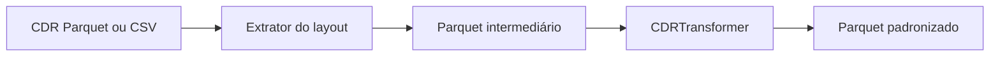

[](https://deepwiki.com/InovaFiscaliza/teleutils)

# TeleUtils

Biblioteca Python para normalizar dados de telecomunicações e processar
registros de chamadas (CDRs) de prestadoras brasileiras. O projeto oferece
funções para números telefônicos e CNPJs, além de extratores e transformadores
Apache Spark que convertem diferentes layouts de CDR em um contrato analítico
comum.

## Sumário

[Visão geral](#visão-geral)

<details>
<summary><a href="#início-rápido">Início rápido</a></summary>

- [Pré-requisitos](#pré-requisitos)
- [Instalação](#instalação)
- [Verificação da instalação](#verificação-da-instalação)

</details>

[Componentes e fluxo](#componentes-e-fluxo)

<details>
<summary><a href="#uso">Uso</a></summary>

- [Pré-processamento em Python](#pré-processamento-em-python)
- [Processamento de CDRs com Spark](#processamento-de-cdrs-com-spark)
- [Orquestração de lotes no Jupyter](#orquestração-de-lotes-no-jupyter)

</details>

[Estrutura do projeto](#estrutura-do-projeto)

[Documentação técnica](#documentação-técnica)

[Desenvolvimento](#desenvolvimento)

[Limitações conhecidas](#limitações-conhecidas)

[⬆ Voltar ao topo](#sumário)

## Visão geral

O `teleutils` atende dois cenários principais:

- normalização e validação de números telefônicos brasileiros, inclusive em
  pandas UDFs, e validação de CNPJ;
- extração de CDRs Parquet ou CSV para uma representação intermediária e
  transformação desse resultado em um dataset Parquet padronizado.

Os layouts de CDR disponíveis são Ericsson, LTE Huawei TIM, LTE Ericsson Vivo,
Nokia e Algar Huawei. O processamento usa Spark e grava os destinos em modo
`overwrite`; a saída transformada é particionada por `no_tipo_chamada`.

[⬆ Voltar ao topo](#sumário)

## Início rápido

### Pré-requisitos

- Python 3.9 ou superior;
- um ambiente Java funcional para os fluxos que iniciam o Apache Spark;
- Git para obter o repositório.

### Instalação

Com `uv`:

```bash
git clone https://github.com/InovaFiscaliza/teleutils.git
cd teleutils
uv sync
```

Para instalar apenas o pacote em um ambiente virtual já ativado:

```bash
python -m pip install .
```

### Verificação da instalação

Execute uma chamada que não precisa iniciar o Spark:

```bash
uv run python -c "from teleutils.preprocessing import normalize_number; print(normalize_number('(11) 99999-9999'))"
```

Resultado esperado:

```text
('11999999999', True)
```

[⬆ Voltar ao topo](#sumário)

## Componentes e fluxo



- `teleutils.preprocessing`: normalização de números e validação de CNPJ em
  Python ou por pandas UDF;
- `teleutils.core.extractors`: leitura, seleção, renomeação e enriquecimento de
  CDRs com metadados de origem;
- `teleutils.core.extractors.schemas`: contratos e catálogos dos layouts
  aceitos pelos extratores;
- `teleutils.core.transformers`: regras específicas por layout e pipeline comum
  de padronização do dataset final;
- `teleutils.core.orchestrators`: validação de configurações e coordenação
  sequencial de extração e transformação, com relatório por item e por lote.

Os extratores podem inferir `prestadora`, `servico`, `tipo_cdr` e `arquivo_origem`
da estrutura `.../operator/service/cdr_type/arquivo`. Os argumentos opcionais
`operator`, `service` e `cdr_type` permitem informar metadados explicitamente;
`_tipo_cdr` do conteúdo, quando presente, prevalece sobre o tipo informado.

[⬆ Voltar ao topo](#sumário)

## Uso

### Pré-processamento em Python

```python
from teleutils.preprocessing import normalize_number, validar_cnpj

numero, numero_valido = normalize_number("(11) 99999-9999")
cnpj_valido = validar_cnpj("11.222.333/0001-81")
```

Também estão disponíveis `normalize_number_pair`, `spark_normalize_number` e
`spark_validar_cnpj`. Consulte assinaturas e contratos na referência da API.

### Processamento de CDRs com Spark

Crie a sessão Spark antes de importar o transformador:

```python
from pyspark.sql import SparkSession

from teleutils.core.extractors import CDRParquetExtractor

spark = SparkSession.builder.appName("teleutils").getOrCreate()

from teleutils.core.transformers import CDRTransformer

extractor = CDRParquetExtractor(spark)
transformer = CDRTransformer(spark)

intermediario = extractor.extract(
    source_file="dados/prestadora/smp/ericsson/entrada.parquet",
    target_file="saida/intermediario/ericsson",
    cdr_schema="smp_ericsson_gsm",
)
resultado = transformer.transform_smp_ericsson_gsm(
    source_file=intermediario,
    target_file="saida/padronizado/ericsson",
)
```

Os métodos retornam o caminho de destino. Tanto a extração quanto a
transformação substituem dados já existentes no destino informado.

### Orquestração de lotes no Jupyter

Use a `SparkSession` já disponibilizada pelo ambiente. O exemplo abaixo usa
um bucket ilustrativo; configure os caminhos e o acesso S3A no ambiente antes
de executá-lo:

```python
from teleutils.core.orchestrators import run_etl

cdr_config = [{
    "storage_type": "s3a",  # Opcional; este é o padrão.
    "source_folder": "bucket-exemplo/cdr/bruto/algar/stfc/huawei_ngn",
    "pattern": "*.gz",
    "schema": "stfc_huawei_ngn",
    "extracted_folder": "bucket-exemplo/cdr/extraido",
    "transformed_folder": "bucket-exemplo/cdr/transformado",
    "output_file_prefix": "algar_huawei_ngn",
    "operator": "algar",
    "service": "stfc",
    "cdr_type": "huawei_ngn",
}]

report = run_etl(cdr_config, spark=spark)
print(report.total, report.successes, report.validation_errors, report.execution_errors)
for item in report.items:
    print(item.index, item.schema, item.status, item.stage, item.error_message)
```

Para um único item, utilize `run_etl_item(cdr_config[0], spark=spark)`.
A configuração aceita os seis campos obrigatórios mostrados, os três metadados
opcionais e `storage_type`, com valores exatos `"s3a"` (padrão) ou `"local"`.
Em S3A, pastas aceitam `bucket/caminho` ou `s3a://bucket/caminho`, nunca
caminhos iniciados por `/`. Endpoint, credenciais e conectores de acesso ao
MinIO/S3A são responsabilidade do ambiente Spark/Hadoop, não da biblioteca.
Os destinos são datasets com sufixos
`_extracted.parquet` e `_transformed.parquet`, não necessariamente arquivos únicos.

Para execução totalmente local, informe diretórios absolutos Linux:

```python
from pyspark.sql import SparkSession
from teleutils.core.orchestrators import run_etl_item

# Em um notebook com sessão existente, reutilize-a em vez de criar outra.
spark = SparkSession.builder.master("local[2]").appName("cdr-local").getOrCreate()

config_local = {
    "storage_type": "local",
    "source_folder": "/dados/cdr/bruto/algar/stfc/huawei_ngn",
    "pattern": "*.gz",
    "schema": "stfc_huawei_ngn",
    "extracted_folder": "/dados/cdr/temp/extraido",
    "transformed_folder": "/dados/cdr/temp/transformado",
    "output_file_prefix": "algar_huawei_ngn",
}
result = run_etl_item(config_local, spark=spark)
print(result.status, result.paths, result.error_message)
```

O modo local gera caminhos `file:///dados/...`, sem depender do filesystem
padrão do Hadoop. Informe `/dados/...` na configuração, não `file:///dados/...`;
caminhos relativos e protocolos explícitos são rejeitados nesse modo.
Os diretórios e dados dos exemplos precisam existir no ambiente do chamador.

Cada item utiliza um único armazenamento para origem e destinos; configurações
híbridas são rejeitadas. Um lote pode conter itens locais e S3A independentes,
sem copiar ou transferir dados entre eles.

Em Spark distribuído, `file:///` aponta para o filesystem de cada máquina:
os caminhos necessários devem estar disponíveis nos executores, não apenas no
driver. A validação é lexical, sem verificar existência, permissões, links
simbólicos ou equivalência entre montagens.

O lote valida os caminhos e resolve os métodos antes da extração. Falhas
individuais são registradas e retornadas, sem impedir itens independentes.
Inspecione o relatório: término do lote não significa sucesso de todos os itens.
O orquestrador não cria/encerra o contexto Spark, não configura handlers de
logging e não executa carga. Se necessário, configure logging no notebook.

Consulte o [contrato da orquestração](docs/teleutils_api.md#teleutilscoreorchestrators)
para validação, conflitos e resultados.

[⬆ Voltar ao topo](#sumário)

## Estrutura do projeto

```text
teleutils/
├── src/teleutils/
│   ├── core/
│   │   ├── extractors/       # extratores e schemas de layouts
│   │   ├── transformers/     # transformação para o contrato final
│   │   ├── loaders/          # carga independente em Iceberg
│   │   └── orchestrators/    # coordenação de extração e transformação
│   └── preprocessing/        # números telefônicos e CNPJ
├── docs/                     # documentação técnica especializada
├── tests/                    # testes e materiais de desenvolvimento
└── pyproject.toml            # metadados e dependências do pacote
```

[⬆ Voltar ao topo](#sumário)

## Documentação técnica

| Documento | Descrição |
| :-- | :-- |
| [Referência da API](docs/teleutils_api.md) | Interfaces públicas, parâmetros, retornos, erros e efeitos colaterais. |
| [Linhagem e transformações dos dados](docs/teleutils_linhagem_transformacoes_dados.md) | Origem, regras de transformação e destino das colunas dos CDRs. |

[⬆ Voltar ao topo](#sumário)

## Desenvolvimento

Instale também as dependências de desenvolvimento e execute a suíte coletada
pelo pytest:

```bash
uv sync --all-groups
uv run pytest
```

O projeto configura `pytest`, `pre-commit` e ferramentas de notebook por meio
do grupo de dependências `dev` em `pyproject.toml`.

[⬆ Voltar ao topo](#sumário)

## Limitações conhecidas

- A orquestração possui testes com fakes e integração Spark local com dados
  sintéticos. Esses testes não certificam o acesso S3A do ambiente Big Data.
- Sucesso técnico não garante completude dos dados: permanecem as políticas
  dos componentes, como `overwrite` e a tolerância a Parquet corrompido.
- Não há transação entre etapas, limpeza de saídas parciais, retries,
  paralelismo, retomada automática ou carga no orquestrador.
- LEGB segue o fluxo genérico. Seu transformador ainda depende de uma correção
  independente para a coluna `_tipo_chamada`; a regressão local sinaliza essa
  pendência como `xfail`, sem adaptação dos dados pelo orquestrador.
- A importação de `teleutils.core.transformers` requer um `SparkContext` ativo
  na implementação atual. Inicie uma `SparkSession` antes desse import.
- Os pipelines Spark dependem dos layouts e da organização de caminhos
  descritos na referência da API e na documentação de linhagem.
